# Arquitectura Portal B2B Himalaya - Diagramas v8

**Fecha**: 01 octubre 2026
**Base**: Diagramas desarrollador (29 sep) + DOCUMENTACION-B2C + v6
**Cambios vs v7**: Agregado diagrama 2b (Integracion B2B aislada) que faltaba del desarrollador

---

## 1. C4 Container

**Leyenda**: Verde = Existente B2C | Naranja = Nuevo B2B | Gris = Compartido

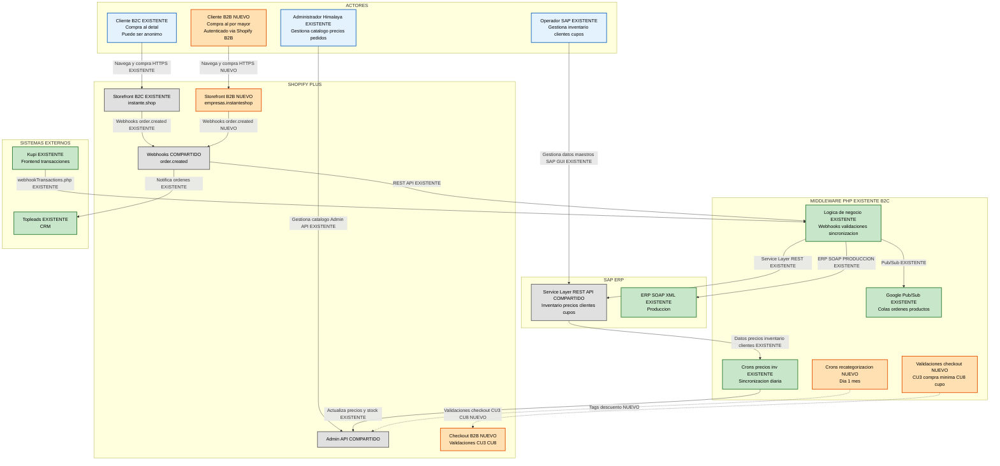

---

## 2. Diagrama de Integracion - Arquitectura General

**Basado en**: Documentacion tecnica real del middleware B2C existente + flujos B2B nuevos

```mermaid
graph TB
    subgraph SAP["SAP ERP"]
        direction LR
        sap_sl["Service Layer REST<br/>Pruebas PRUEBAS HIMA 20ENE"]
        sap_erp["ERP SOAP XML<br/>Produccion HBT AGR HIMA PRUEBA"]
        precios["Precios"]
        inventario["Inventario"]
        clientes["Clientes"]
        cupos["Cupos de credito"]
        historial["Historial compras"]
    end

    subgraph PUBSUB["Google Pub/Sub EXISTENTE"]
        topic_ordenes["Topic himalaya ordenes"]
        topic_productos["Topic himalaya productos"]
        cola_ordenes["Cola ordenes pull"]
        cola_productos["Cola productos pull"]
    end

    subgraph MW["PHP Middleware EXISTENTE B2C"]
        direction LR
        webhook["webhook.php<br/>Recibe ordenes Shopify"]
        pub_ordenes["Publica en Pub/Sub"]
        sub_ordenes["sub.php<br/>Consume ordenes Pub/Sub"]
        pub_catalogo["pub.php<br/>Publica productos Pub/Sub"]
        sub_catalogo["sub.php<br/>Consume productos Pub/Sub"]
        sync_precios["Cron Sinc Precios B2C"]
        sync_inv["Cron Sinc Inventario B2C"]
        sync_cli_batch["Clientes Batch desde SAP B2B NUEVO"]
        validacion_credit["Validacion Cupo B2B NUEVO"]
        recategorizacion["Recategorizacion B2B NUEVO"]
        crea_cliente_sap["Crea cliente en SAP B2C"]
        ordenes_b2b["Ordenes B2B NUEVO"]
        kupi_handler["OrdenPagoKupi<br/>webhookTransactions.php EXISTENTE"]
    end

    subgraph Shopify["Shopify Plus"]
        direction LR
        storefront_b2c["Storefront B2C instante.shop"]
        storefront_b2b["Storefront B2B empresas.instanteshop"]
        admin["Admin API"]
        webhooks_sh["Webhooks order.created"]
        checkout_b2c["Checkout B2C"]
        checkout_b2b["Checkout B2B NUEVO"]
    end

    subgraph EXTERNOS["Sistemas Externos"]
        kupi["Kupi Frontend EXISTENTE"]
        topleads["Topleads CRM EXISTENTE"]
        email["Email Service EXISTENTE"]
    end

    %% Flujo ordenes B2C y B2B
    webhooks_sh -->|"1 order.created"| webhook
    webhook -->|"2 publica payload"| pub_ordenes
    pub_ordenes -->|"3 topic"| topic_ordenes
    topic_ordenes -->|"4 pull"| cola_ordenes
    cola_ordenes -->|"5 consume"| sub_ordenes
    sub_ordenes -->|"6 envia pedido"| sap_erp

    %% Flujo ordenes B2B
    checkout_b2b -->|"valida reglas"| validacion_credit
    validacion_credit -->|"consulta cupo"| cupos
    cupos -->|"response"| validacion_credit
    validacion_credit -->|"aprueba o rechaza"| checkout_b2b
    checkout_b2b -->|"genera orden"| webhooks_sh
    webhooks_sh -->|"webhook"| ordenes_b2b
    ordenes_b2b -->|"envia pedido"| sap_erp

    %% Flujo catalogo
    pub_catalogo -->|"publica productos"| topic_productos
    topic_productos -->|"pull"| cola_productos
    cola_productos -->|"consume"| sub_catalogo
    sub_catalogo -->|"crea actualiza productos"| admin

    %% Flujo precios e inventario
    precios -->|"Cron consume SAP"| sync_precios
    sync_precios -->|"Actualiza precios"| storefront_b2c
    sync_precios -->|"Actualiza precios B2B"| storefront_b2b

    inventario -->|"Cron consume SAP"| sync_inv
    sync_inv -->|"Actualiza stock"| storefront_b2c
    sync_inv -->|"Actualiza stock B2B"| storefront_b2b

    %% Flujo clientes B2B
    clientes -->|"Listado batch"| sync_cli_batch
    sync_cli_batch -->|"Crea actualiza en Shopify"| admin

    %% Flujo recategorizacion
    historial -->|"Dia 1 mes"| recategorizacion
    recategorizacion -->|"Tags descuento"| storefront_b2b

    %% Flujo Kupi
    kupi -->|"webhook transacciones"| kupi_handler
    kupi_handler -->|"registra en SAP"| sap_erp

    %% Notificaciones
    webhooks_sh -->|"notifica"| topleads
    webhooks_sh -->|"notifica"| email

    %% Estilos
    classDef b2c fill:#c8e6c9,stroke:#2e7d32,stroke-width:2px,color:#000
    classDef b2b fill:#ffe0b2,stroke:#e65100,stroke-width:2px,color:#000
    classDef shared fill:#e0e0e0,stroke:#616161,stroke-width:2px,color:#000
    classDef pubsub fill:#e1f5fe,stroke:#0288d1,stroke-width:2px,color:#000

    class sync_precios,sync_inv,checkout_b2c,crea_cliente_sap,webhook,pub_ordenes,sub_ordenes,pub_catalogo,sub_catalogo,kupi_handler b2c
    class validacion_credit,recategorizacion,sync_cli_batch,checkout_b2b,ordenes_b2b,storefront_b2b b2b
    class admin,webhooks_sh,precios,inventario,clientes,cupos,historial shared
    class topic_ordenes,topic_productos,cola_ordenes,cola_productos pubsub
```

---

## 3. Diagrama de Integracion B2B (Solo flujos B2B)

**Incluye**:
- Creacion clientes desde Batch SAP
- Checkout → webhook → validacion compra minima → pedido SAP
- Sincronizacion inventario catalogo B2B
- Sincronizacion precios catalogo B2B
- Validacion cupo credito (checkout → middleware → SAP)
- Recategorizacion

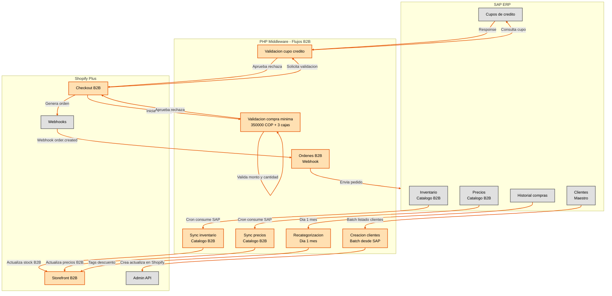

---

## 4. Diagrama de Secuencia - Flujo de Compra B2C

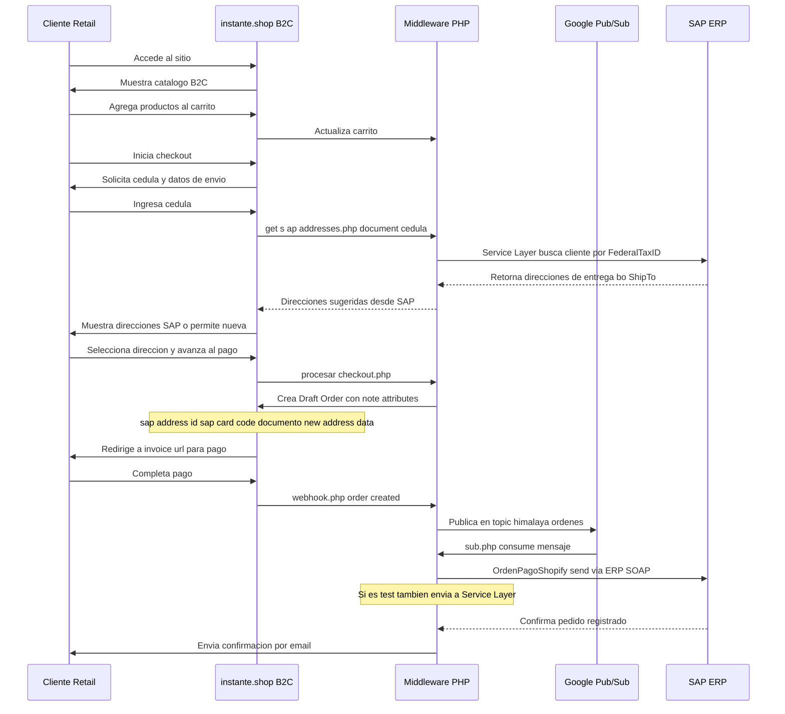

---

## 5. Diagrama de Secuencia - Flujo de Compra B2B

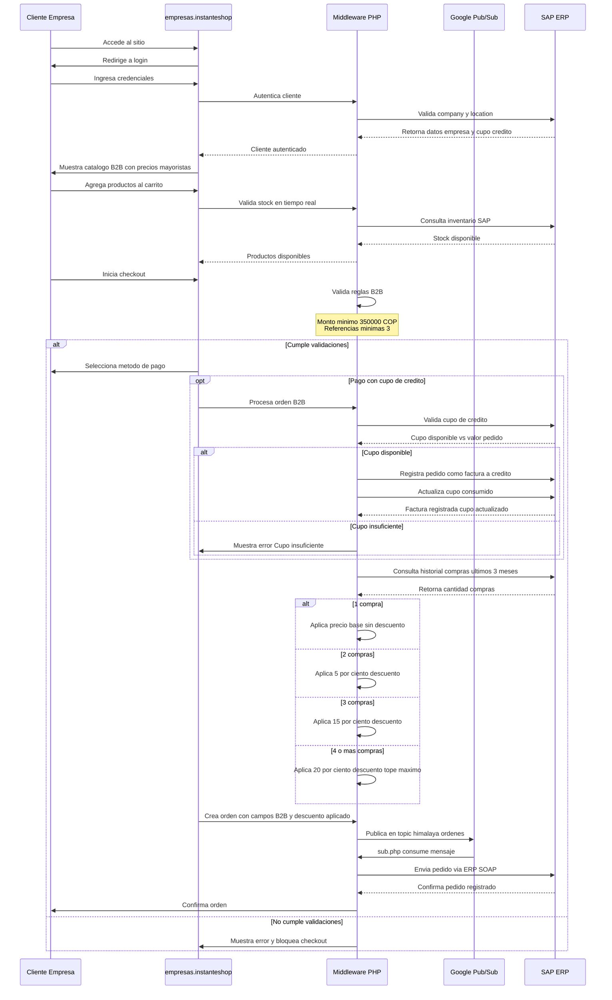

---

## 6. Diagrama de Secuencia - CU1 Recategorizacion Mensual

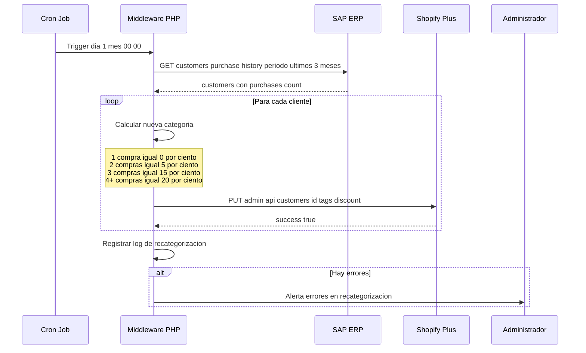

---

## 7. Diagrama de Secuencia - CU3 Validacion Compra Minima

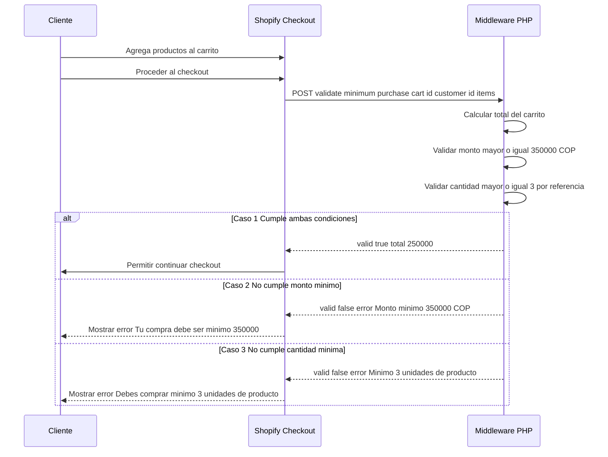

---

## 8. Diagrama de Secuencia - CU9 Sincronizacion Inventario

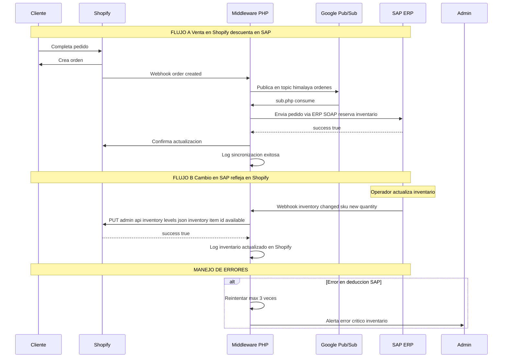

---

## 9. Diagrama de Componentes - Storefront B2B

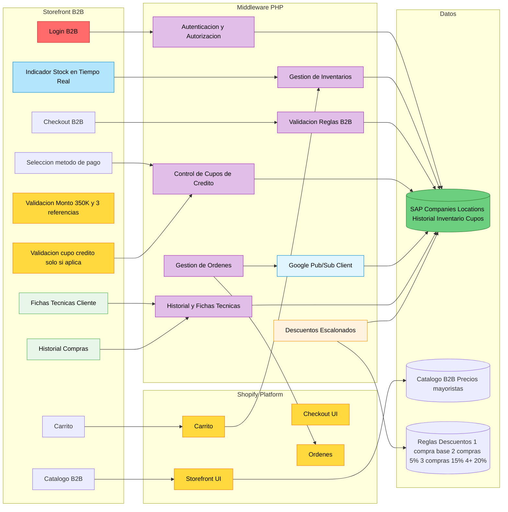

---

## 10. Diagrama de Flujo de Datos - Cliente B2B

```mermaid
flowchart TD
    A["Cliente empresa accede empresas.instanteshop"] --> B{"Autenticado"}
    B -->|No| C["Login con credenciales"]
    C --> D["Middleware autentica en SAP"]
    D --> E{"Empresa valida"}
    E -->|No| F["Error No autorizado"]
    E -->|Si| G["Obtiene company y location"]
    G --> H["Carga catalogo B2B con precios mayoristas"]

    B -->|Si| H

    H --> I["Cliente navega productos"]
    I --> J["Middleware consulta stock en SAP"]
    J --> K{"Stock disponible"}
    K -->|Si| L["Muestra producto disponible"]
    K -->|No| M["Muestra Agotado o No disponible"]
    K -->|Limitado| N["Muestra Stock limitado"]

    L --> O["Agrega al carrito"]
    O --> P["Middleware valida reglas B2B Monto 350000 y Referencias 3"]

    P -->|No cumple| Q["Bloquea checkout Muestra mensaje error"]
    P -->|Cumple| R["Procede al checkout"]

    R --> S{"Elige pagar con cupo de credito"}
    S -->|Si| T["Middleware revisa cupo en SAP"]
    T --> U{"Cupo disponible"}
    U -->|No| V["Error Cupo insuficiente"]
    U -->|Si| W["Middleware registra factura a credito en SAP"]
    W --> X["Middleware actualiza cupo consumido en SAP"]
    X --> Y["Middleware calcula descuento por frecuencia"]
    S -->|No tarjeta o transferencia| Y

    Y --> Z["Middleware consulta compras ultimos 3 meses en SAP"]
    Z --> AA{"Cuantas compras en 3 meses"}
    AA -->|1 compra| AB["Precio base sin descuento"]
    AA -->|2 compras| AC["5% descuento"]
    AA -->|3 compras| AD["15% descuento"]
    AA -->|4 o mas compras| AE["20% descuento tope maximo"]

    AB --> AF["Middleware reserva inventario en SAP"]
    AC --> AF
    AD --> AF
    AE --> AF

    AF --> AG["Middleware publica orden en Google Pub/Sub"]
    AG --> AH["sub.php consume y envia pedido a SAP ERP SOAP"]
    AH --> AI["Confirma orden"]
    AI --> AJ["Envia email confirmacion"]

    AL["Cliente consulta ficha tecnica"] --> AM["Middleware muestra datos empresa NIT contacto ubicacion"]
    AM --> AN["Middleware muestra historial completo de pedidos"]
    AN --> AO["Middleware muestra patrones productos mas comprados frecuencia valor promedio"]

    style A fill:#e1f5ff,stroke:#0168c1,color:#000
    style F fill:#ffcdd2,stroke:#c62828,color:#000
    style Q fill:#ffcdd2,stroke:#c62828,color:#000
    style V fill:#ffcdd2,stroke:#c62828,color:#000
    style AJ fill:#c8e6c9,stroke:#2e7d32,color:#000
    style AC fill:#fff3e0,stroke:#ff9800,color:#000
    style AD fill:#fff3e0,stroke:#ff9800,color:#000
    style AE fill:#fff3e0,stroke:#ff9800,color:#000
    style M fill:#ffcdd2,stroke:#c62828,color:#000
    style N fill:#fff9c4,stroke:#f57f17,color:#000
    style B fill:#fff4e1,stroke:#ff8c00,color:#000
    style E fill:#fff4e1,stroke:#ff8c00,color:#000
    style K fill:#fff4e1,stroke:#ff8c00,color:#000
    style S fill:#fff4e1,stroke:#ff8c00,color:#000
    style U fill:#fff4e1,stroke:#ff8c00,color:#000
    style AA fill:#fff4e1,stroke:#ff8c00,color:#000
```

---

## 11. Diagrama de Estados - Orden B2B

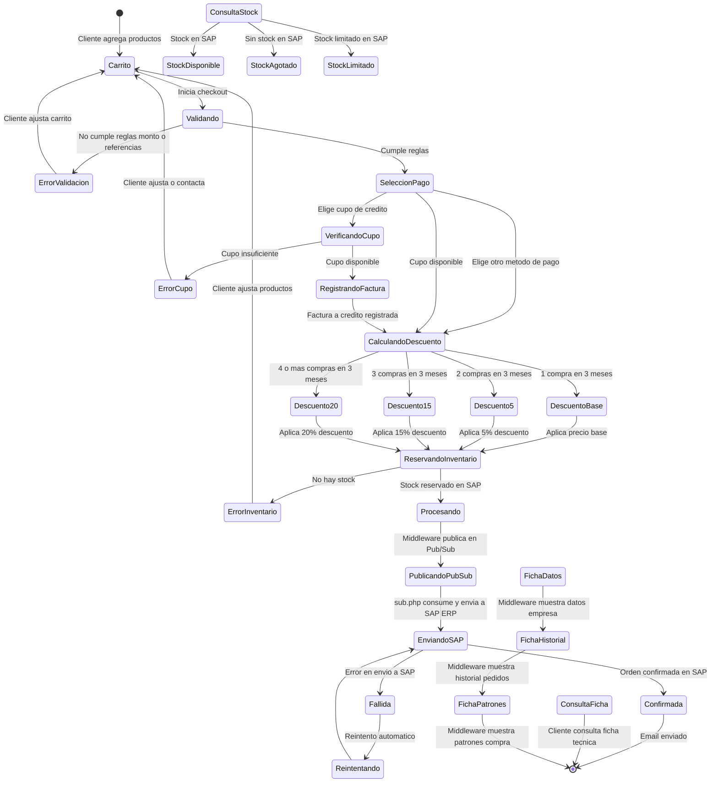

---

## 12. Diagrama de Despliegue - Infraestructura

```mermaid
graph TB
    subgraph Internet["Internet"]
        Users["Usuarios Retail y Empresas"]
    end

    subgraph CDN["CDN"]
        Cloudflare["Cloudflare Cache y SSL"]
    end

    subgraph FrontendHosting["Frontend Hosting"]
        B2CHost["instante.shop Vercel o Netlify"]
        B2BHost["empresas.instanteshop Vercel o Netlify"]
        FichasHost["Fichas Tecnicas Frontend"]
    end

    subgraph ShopifyPlatform["Shopify Platform"]
        ShopifyStorefront["Shopify Storefront"]
        ShopifyCart["Shopify Cart"]
        ShopifyCheckout["Shopify Checkout UI"]
        ShopifyOrders["Shopify Orders"]
        ShopifyWebhooks["Shopify Webhooks"]
    end

    subgraph MiddlewareServer["Middleware Server PHP"]
        MiddlewareAPI["Middleware API Server"]
        WebhookHandler["webhook.php"]
        PubSubPublisher["Publicador Pub/Sub"]
        PubSubSubscriber["Suscriptor Pub/Sub sub.php"]
        CatalogoPub["pub.php catalogo"]
        CatalogoSub["sub.php catalogo"]
        AuthService["Servicio de Autenticacion"]
        ValidationService["Servicio de Validacion B2B"]
        CreditService["Servicio de Control de Cupos"]
        DiscountService["Servicio de Descuentos"]
        InventoryService["Servicio de Inventarios"]
        OrderService["Servicio de Ordenes"]
        HistoryService["Servicio de Historial y Fichas"]
        KupiHandler["webhookTransactions.php"]
    end

    subgraph GoogleCloud["Google Cloud"]
        PubSub["Pub/Sub Topics y Colas"]
    end

    subgraph BackendServices["Backend Services"]
        Recategorization["Recategorization Cron Job Primer dia mes"]
    end

    subgraph Databases["Databases"]
        ShopifyDB[("Shopify DB Productos Clientes Ordenes")]
        SAPSL[("SAP Service Layer REST Pruebas")]
        SAPERP[("SAP ERP SOAP XML Produccion")]
        DiscountDB[("Discount DB Reglas escalonadas")]
        LocalFiles[("Archivos locales catalogo import JSON markers logs")]
    end

    Users --> Cloudflare
    Cloudflare --> B2CHost
    Cloudflare --> B2BHost
    Cloudflare --> FichasHost

    B2CHost --> ShopifyStorefront
    B2BHost --> ShopifyStorefront
    FichasHost --> MiddlewareAPI

    ShopifyStorefront --> ShopifyCart
    ShopifyCart --> ShopifyCheckout
    ShopifyCheckout --> MiddlewareAPI

    ShopifyOrders --> ShopifyWebhooks
    ShopifyWebhooks --> WebhookHandler
    WebhookHandler --> PubSubPublisher
    PubSubPublisher --> PubSub
    PubSub --> PubSubSubscriber
    PubSubSubscriber --> OrderService

    MiddlewareAPI --> AuthService
    MiddlewareAPI --> ValidationService
    MiddlewareAPI --> CreditService
    MiddlewareAPI --> DiscountService
    MiddlewareAPI --> InventoryService
    MiddlewareAPI --> OrderService
    MiddlewareAPI --> HistoryService
    MiddlewareAPI --> KupiHandler

    AuthService --> SAPSL
    AuthService --> SAPERP
    ValidationService --> SAPERP
    CreditService --> SAPERP
    DiscountService --> DiscountDB
    DiscountService --> SAPERP
    InventoryService --> SAPERP
    OrderService --> SAPERP
    OrderService --> ShopifyDB
    HistoryService --> SAPERP
    KupiHandler --> SAPERP

    CatalogoPub --> PubSub
    PubSub --> CatalogoSub
    CatalogoSub --> ShopifyDB
    CatalogoSub --> LocalFiles

    Recategorization --> DiscountService
    Recategorization --> SAPERP

    style Users fill:#e1f5ff,stroke:#0168c1,color:#000
    style Cloudflare fill:#fff4e1,stroke:#ff8c00,color:#000
    style ShopifyStorefront fill:#ffd93d,stroke:#f57f17,color:#000
    style ShopifyCart fill:#ffd93d,stroke:#f57f17,color:#000
    style ShopifyCheckout fill:#ffd93d,stroke:#f57f17,color:#000
    style ShopifyOrders fill:#ffd93d,stroke:#f57f17,color:#000
    style ShopifyWebhooks fill:#ffd93d,stroke:#f57f17,color:#000
    style MiddlewareAPI fill:#e1bee7,stroke:#9c27b0,color:#000
    style WebhookHandler fill:#e1bee7,stroke:#9c27b0,color:#000
    style PubSubPublisher fill:#e1bee7,stroke:#9c27b0,color:#000
    style PubSubSubscriber fill:#e1bee7,stroke:#9c27b0,color:#000
    style CatalogoPub fill:#e1bee7,stroke:#9c27b0,color:#000
    style CatalogoSub fill:#e1bee7,stroke:#9c27b0,color:#000
    style AuthService fill:#e1bee7,stroke:#9c27b0,color:#000
    style ValidationService fill:#e1bee7,stroke:#9c27b0,color:#000
    style CreditService fill:#e1bee7,stroke:#9c27b0,color:#000
    style DiscountService fill:#e1bee7,stroke:#9c27b0,color:#000
    style InventoryService fill:#e1bee7,stroke:#9c27b0,color:#000
    style OrderService fill:#e1bee7,stroke:#9c27b0,color:#000
    style HistoryService fill:#e1bee7,stroke:#9c27b0,color:#000
    style KupiHandler fill:#e1bee7,stroke:#9c27b0,color:#000
    style PubSub fill:#e1f5fe,stroke:#0288d1,color:#000
    style SAPSL fill:#6bcf7f,stroke:#2e7d32,color:#000
    style SAPERP fill:#6bcf7f,stroke:#2e7d32,color:#000
    style ShopifyDB fill:#6bcf7f,stroke:#2e7d32,color:#000
    style DiscountDB fill:#fff3e0,stroke:#ff9800,color:#000
    style LocalFiles fill:#f5f5f5,stroke:#9e9e9e,color:#000
```

---

## 13. Diagrama de Casos de Uso

```mermaid
graph TB
    subgraph Actores["Actores"]
        Retail["Cliente Retail"]
        Empresa["Cliente Empresa"]
        Admin["Administrador"]
        SAP["SAP System"]
        MW["Middleware PHP"]
        PubSub["Google Pub/Sub"]
        Cron["Cron Mensual"]
        Kupi["Kupi Frontend"]
    end

    subgraph CasosUsoB2C["Casos de Uso B2C"]
        B2C1["Navegar catalogo B2C"]
        B2C2["Comprar como invitado"]
        B2C3["Registrarse opcionalmente"]
        B2C4["Ver precios retail"]
        B2C5["Ver stock en tiempo real"]
        B2C6["Consultar direcciones SAP en checkout"]
    end

    subgraph CasosUsoB2B["Casos de Uso B2B"]
        B2B1["Login obligatorio"]
        B2B2["Ver catalogo B2B precios mayoristas"]
        B2B3["Validacion monto minimo 350K"]
        B2B4["Validacion referencias minimas 3"]
        B2B5["Verificacion cupo credito solo si elige este metodo"]
        B2B6["Comprar con validaciones"]
        B2B7["Seleccionar metodo de pago"]
        B2B8["CU-01 Descuentos escalonados por frecuencia"]
        B2B9["CU-02 Fichas tecnicas con historial"]
        B2B10["CU-08 Control de cupos de credito y validacion en checkout POSTPRODUCCION"]
        B2B11["CU-09 Gestion de inventarios en tiempo real via middleware"]
    end

    subgraph CasosUsoMiddleware["Casos de Uso Middleware"]
        MW1["Recibir webhook order.created"]
        MW2["Publicar orden en Pub/Sub"]
        MW3["Consumir mensajes Pub/Sub"]
        MW4["Enviar pedido a SAP ERP SOAP"]
        MW5["Enviar pedido a SAP Service Layer test"]
        MW6["Sincronizar catalogo via Pub/Sub"]
        MW7["Gestionar markers no sobrescribir"]
        MW8["Procesar transacciones Kupi"]
    end

    subgraph CasosUsoAdmin["Casos de Uso Admin"]
        Admin1["Gestionar catalogos"]
        Admin2["Configurar reglas B2B"]
        Admin3["Ver reportes"]
        Admin4["Sincronizar con SAP"]
        Admin5["Ver fichas tecnicas clientes"]
        Admin6["Configurar descuentos escalonados"]
        Admin7["Monitorear middleware"]
        Admin8["Ver inventario en tiempo real"]
    end

    subgraph ProcesosAutomaticos["Procesos Automaticos"]
        Cron1["CU-01 Recategorizacion primer dia del mes"]
        Cron2["Calculo compras ultimos 3 meses"]
        Sync1["Sincronizacion inventario bidireccional"]
        Sync2["Sincronizacion cupos bidireccional"]
        Sync3["Sincronizacion ordenes bidireccional"]
        Sync4["Sincronizacion catalogo diario Pub/Sub"]
    end

    Retail --> B2C1
    Retail --> B2C2
    Retail --> B2C3
    Retail --> B2C4
    Retail --> B2C5
    Retail --> B2C6

    Empresa --> B2B1
    Empresa --> B2B2
    Empresa --> B2B3
    Empresa --> B2B4
    Empresa --> B2B5
    Empresa --> B2B6
    Empresa --> B2B7
    Empresa --> B2B8
    Empresa --> B2B9
    Empresa --> B2B10
    Empresa --> B2B11

    MW --> MW1
    MW --> MW2
    MW --> MW3
    MW --> MW4
    MW --> MW5
    MW --> MW6
    MW --> MW7
    MW --> MW8

    PubSub --> MW2
    PubSub --> MW3

    Kupi --> MW8

    Admin --> Admin1
    Admin --> Admin2
    Admin --> Admin3
    Admin --> Admin4
    Admin --> Admin5
    Admin --> Admin6
    Admin --> Admin7
    Admin --> Admin8

    Cron --> Cron1
    Cron1 --> Cron2
    Cron2 --> B2B8

    MW --> Sync1
    MW --> Sync2
    MW --> Sync3
    MW --> Sync4
    Sync1 --> B2B11
    Sync2 --> B2B10

    SAP --> B2B5
    SAP --> B2B8
    SAP --> B2B9
    SAP --> B2B10
    SAP --> B2B11
    SAP --> Admin4
    SAP --> MW4
    SAP --> MW5

    MW --> B2B3
    MW --> B2B4
    MW --> B2B5
    MW --> B2B8
    MW --> B2B9
    MW --> B2B10
    MW --> B2B11

    style Retail fill:#e1f5ff,stroke:#0168c1,color:#000
    style Empresa fill:#fff4e1,stroke:#ff8c00,color:#000
    style Admin fill:#f0f0f0,stroke:#666,color:#000
    style SAP fill:#6bcf7f,stroke:#2e7d32,color:#000
    style MW fill:#e1bee7,stroke:#9c27b0,color:#000
    style PubSub fill:#e1f5fe,stroke:#0288d1,color:#000
    style Kupi fill:#f3e5f5,stroke:#7b1fa2,color:#000
    style B2B8 fill:#fff3e0,stroke:#ff9800,color:#000
    style B2B9 fill:#e8f5e9,stroke:#4caf50,color:#000
    style B2B10 fill:#fce4ec,stroke:#c62828,color:#000
    style B2B11 fill:#e1bee7,stroke:#9c27b0,color:#000
    style Cron fill:#f3e5f5,stroke:#7b1fa2,color:#000
```

---

## 14. Contratos API - OpenAPI 3.0

```yaml
openapi: 3.0.0
info:
  title: Himalaya B2B Middleware API
  version: 1.0.0
  description: API del middleware PHP de integracion SAP Shopify para Portal B2B Agricola Himalaya

servers:
  - url: https://middleware.himalaya.com.co/api/v1

paths:
  /validate-minimum-purchase:
    post:
      summary: Valida CU3 - Compra minima
      description: Valida monto minimo 350000 COP y 3 cajas por referencia
      security:
        - ApiKeyAuth: []
      requestBody:
        required: true
        content:
          application/json:
            schema:
              type: object
              properties:
                cart_id:
                  type: string
                customer_id:
                  type: string
                items:
                  type: array
                  items:
                    type: object
                    properties:
                      sku:
                        type: string
                      quantity:
                        type: integer
                      unit_of_measure:
                        type: string
                        enum: [unidad, caja, paca]
      responses:
        '200':
          description: Validacion exitosa
          content:
            application/json:
              schema:
                type: object
                properties:
                  valid:
                    type: boolean
                  total:
                    type: number
                  error_message:
                    type: string
        '400':
          description: No cumple minimo
        '404':
          description: Cliente no encontrado

  /recategorize-customers:
    post:
      summary: Ejecuta CU1 - Recategorizacion mensual
      description: Recalcula descuentos por frecuencia de compra dia 1 de cada mes
      security:
        - ApiKeyAuth: []
      responses:
        '200':
          description: Recategorizacion completada
          content:
            application/json:
              schema:
                type: object
                properties:
                  processed:
                    type: integer
                  errors:
                    type: integer

  /customer/{id}/profile:
    get:
      summary: Retorna CU2 - Ficha tecnica del cliente
      description: Historial y patrones de compra
      security:
        - ApiKeyAuth: []
      parameters:
        - name: id
          in: path
          required: true
          schema:
            type: string
      responses:
        '200':
          description: Perfil del cliente
          content:
            application/json:
              schema:
                type: object
                properties:
                  customer_data:
                    type: object
                  order_history:
                    type: array
                  top_products:
                    type: array
                  avg_order_value:
                    type: number
                  frequency:
                    type: string

  /inventory/sync:
    post:
      summary: CU9 - Sincronizacion de inventario SAP Shopify
      security:
        - ApiKeyAuth: []
      requestBody:
        required: true
        content:
          application/json:
            schema:
              type: object
              properties:
                skus:
                  type: array
                  items:
                    type: object
                    properties:
                      sku:
                        type: string
                      quantity:
                        type: integer
      responses:
        '200':
          description: Sincronizacion completada
          content:
            application/json:
              schema:
                type: object
                properties:
                  updated:
                    type: integer
                  errors:
                    type: integer

  /validate-credit-limit:
    post:
      summary: CU8 - Validacion de cupo de credito POSTPRODUCCION
      description: Valida cupo de credito en SAP antes de crear pedido
      security:
        - ApiKeyAuth: []
      requestBody:
        required: true
        content:
          application/json:
            schema:
              type: object
              properties:
                customer_id:
                  type: string
                order_total:
                  type: number
      responses:
        '200':
          description: Validacion de cupo
          content:
            application/json:
              schema:
                type: object
                properties:
                  approved:
                    type: boolean
                  available_credit:
                    type: number

components:
  securitySchemes:
    ApiKeyAuth:
      type: apiKey
      in: header
      name: X-API-Key
```

---

## Notas de Implementacion

### Arquitectura General
- **Shopify**: Solo plataforma de ecommerce (storefront, carrito, checkout UI, ordenes basicas)
- **Middleware PHP**: Contiene TODA la logica de negocio (validaciones, descuentos, cupos, inventario, autenticacion, fichas tecnicas)
- **Google Pub/Sub**: Mensajeria asincrona para ordenes (topic himalaya ordenes) y productos (topic himalaya productos)
- **SAP**: Sistema fuente de datos con dos interfaces
  - **Service Layer REST API**: Entorno de pruebas (PRUEBAS HIMA 20ENE)
  - **ERP SOAP XML**: Entorno de produccion (HBT AGR HIMA PRUEBA) - flujo principal actual
- **Comunicacion**: Shopify --> Middleware --> Pub/Sub --> SAP (ordenes asincronas)
- **Kupi**: Frontend externo que procesa transacciones via webhookTransactions.php

### Middleware PHP - Scripts Principales
- **webhook.php**: Recibe webhooks de Shopify y publica en Pub/Sub
- **catalogo/pub.php**: Publica productos en Pub/Sub para sincronizacion
- **catalogo/sub.php**: Consume productos de Pub/Sub y actualiza Shopify
- **catalogo/forzar sync.php**: Sincroniza SKUs especificos sin pasar por Pub/Sub
- **ordenes/sub.php**: Consume ordenes de Pub/Sub y envia a SAP
- **get s ap addresses.php**: Consulta direcciones de entrega en SAP por cedula
- **procesar checkout.php**: Crea Draft Order en Shopify con note attributes
- **webhookTransactions.php**: Procesa transacciones de Kupi

### Sistema de Markers (no sobrescribir)
- **Proposito**: Permitir que productos con datos incompletos de SAP se suban a Shopify una sola vez sin sobrescritura
- **Mecanismo**: Archivo marker en logs/catalogo/tracker/pushed SKU.marker
- **Excepcion SKU 17600521**: Se permite creacion aunque Item este vacio (asigna titulo placeholder)
- **Reset**: Eliminar el marker para forzar resync

### Reglas de Negocio B2B
- **Monto minimo**: 350.000 COP (CORREGIDO vs v6 que tenia inconsistencia con 150K)
- **Referencias minimas**: 3 productos diferentes
- **Autenticacion**: Obligatoria (company y location desde SAP)
- **Cupo credito**: Solo se valida si el cliente elige pagar con cupo de credito en el checkout
  - Si elige otro metodo de pago (tarjeta, transferencia, etc.): flujo normal sin validacion de cupo

### CU-01: Descuentos Escalonados por Frecuencia
- **Escala de descuentos**:
  - 1 compra: precio base (sin descuento)
  - 2 compras: 5% descuento
  - 3 compras: 15% descuento
  - 4+ compras: 20% descuento (tope maximo)
- **Recategorizacion mensual**: Ejecutada el PRIMER DIA de cada mes
- **Ventana temporal**: Basada en ventas de los ULTIMOS 3 MESES (no acumuladas historicamente)
- **Implementacion**: Cron interno del middleware con integracion con SAP
- **Aplicacion**: Automatica en el checkout segun historial de compras

### CU-02: Fichas Tecnicas de Clientes con Historial
- **Datos incluidos**:
  - Datos basicos: nombre, NIT, contacto
  - Ubicacion de la empresa
  - Historial completo: todos los pedidos con fecha y valor
  - Patrones de compra: productos mas comprados, frecuencia, valor promedio
- **Objetivo**: Marketing y segmentacion
- **Implementacion**: Actividades de Backend (Middleware) y Frontend
- **Origen de datos**: SAP (historial de compras) via Middleware + Shopify (datos de pedidos)

### CU-03: Restriccion de Compra Minima
- **Monto minimo**: 350.000 COP
- **Referencias minimas**: 3 productos diferentes
- **Validacion**: En el checkout antes de permitir continuar (ejecutada por el Middleware)
- **Mensaje de error**: Si no cumple alguna regla, se bloquea y muestra mensaje

### CU-08: Control de Cupos de Credito y Validacion en Checkout
- **Estado**: POSTPRODUCCION (no implementado en fase inicial)
- **Descripcion**: Sistema gestiona cupos de credito asignados a cada cliente B2B, validando que el cliente tenga cupo disponible antes de permitir la creacion del pedido
- **Flujo**:
  1. Cliente inicia checkout
  2. Middleware consulta cupo en SAP
  3. Valida cupo disponible vs valor pedido
  4. Si no hay cupo: muestra Cupo insuficiente
  5. Si hay cupo: cliente paga contra cupo
  6. Middleware registra pedido como factura a credito en SAP
  7. Middleware actualiza cupo consumido en SAP
- **Criterios**:
  - Cupo se consulta en SAP en tiempo real via Middleware
  - Valida cupo disponible vs valor pedido
  - Si no hay cupo: Cupo insuficiente
  - Disponible: Pedido se registra como factura a credito
  - Cupo consumido se actualiza automaticamente
  - Pagos liberan cupo (sincronizacion desde SAP via Middleware)
- **Nota**: Solo puede hacerse en la version Plus de Shopify
- **Implementacion**: Actividades Back y Front - Requiere Middleware con logica de negocio

### CU-09: Gestion de Inventarios en Tiempo Real via Middleware
- **Descripcion**: Sistema sincroniza inventario de productos en tiempo real entre SAP y Shopify mediante middleware, asegurando que clientes B2B vean stock actualizado
- **Flujo**:
  1. SAP mantiene inventario actualizado
  2. Middleware sincroniza con Shopify via Pub/Sub (comunicacion bidireccional)
  3. Sistema actualiza stock en portal B2B
  4. Cliente ve inventario actualizado
  5. Al crear pedido, Middleware valida y reserva inventario en SAP
  6. Middleware confirma reserva en SAP
- **Criterios**:
  - Inventario se sincroniza desde SAP a Shopify en tiempo real via Middleware y Pub/Sub
  - Stock mostrado refleja inventario disponible en SAP
  - Si stock es 0: Agotado o No disponible
  - Si stock es bajo: Stock limitado
  - Al crear pedido, Middleware valida stock en tiempo real
  - Inventario se reserva temporalmente
  - Middleware confirma reserva en SAP
  - Si hay error, muestra ultimo inventario conocido con timestamp
- **Comunicacion**: Bidireccional Shopify - Middleware - Pub/Sub - SAP
- **Implementacion**: Backend - comunicacion bidireccional via Middleware y Google Pub/Sub

### Entornos y Modos de Ejecucion
| Parametro | ERP Clasico (Produccion) | Service Layer (Pruebas) |
|---|---|---|
| Objetivo | Produccion en vivo | Pruebas de integracion |
| Protocolo | SOAP XML Web Service | REST API JSON |
| Endpoint SAP | http://agricola-himalaya... | https://vm-hbt-hm13...:50000/b1s/v1 |
| Compania DB | HBT AGR HIMA PRUEBA (Prod) | PRUEBAS HIMA 20ENE (Pruebas) |
| Flujo Paralelo | Siempre activo | Activado por TEST MODE o documento de prueba |

### Modo Prueba
El flujo paralelo a Service Layer se evalua en OrdenPagoShopify isTestMode(). Devuelve true si:
1. Existe configuracion global en config.php con TEST MODE igual true
2. El documento del comprador coincide con los autorizados en TEST DOCUMENTS (ej. 1102774916)

### Packs (Bundles - Explosion Nativa de BOM)
- **Identificacion**: Middleware consulta composicion en cache (cache packs.json) alimentada por ServiceLayer getPackComposition()
- **Envio a SAP**: Unicamente la linea del Pack Padre con TreeType iSalesTree y bodega especifica (ej. 103)
- **Orquestacion Transaccional de Borradores (Draft Flow)**:
  1. ServiceLayer sendPedido() crea borrador (POST /Drafts)
  2. SAP realiza explosion nativa de forma sincrona
  3. Sistema detecta lineas hijas (TreeType iIngredient) con bodegas predeterminadas
  4. Asigna bodega del padre mediante PATCH /Drafts(DocEntry)
  5. Borrador se convierte a pedido real con /DraftsService SaveDraftToDocument
- **Validado**: Ordenes 60273 y 60925 en base de pruebas

### Diferenciacion de Catalogos
- **B2C**: Catalogo completo con precios retail
- **B2B**: Catalogo con precios mayoristas mas productos exclusivos B2B
- Shopify permite hasta 3 catalogos simultaneos

### Webhooks
- No se requiere webhook separado por canal
- Pedidos B2B incluyen campos adicionales que los identifican
- Mismo webhook maneja ambos tipos de ordenes
- Webhooks se integran con el Middleware para sincronizacion con SAP via Pub/Sub

### Integracion SAP
- Companies y Locations se sincronizan desde SAP via Middleware
- Cupo de credito se valida en tiempo real SOLO cuando el cliente elige pagar con cupo de credito
- Historial de compras se sincroniza para fichas tecnicas y calculo de descuentos
- Inventario se sincroniza bidireccionalmente en tiempo real via Middleware y Pub/Sub
- No se muestra modelo de datos de SAP al cliente

### Pendientes
- Reunion con Alejandro (8 oct): servidor, gift cards, estructura productos
- Definir si login B2B es nativo de Shopify o custom
- Ajustar mutaciones GraphQL para parametro de catalogo
- Definir arquitectura de backend para CU-01 (descuentos escalonados)
- Definir estructura de fichas tecnicas para CU-02 (frontend y backend)
- Confirmar que CU-08 solo aplica para version Plus de Shopify
- Definir manejo de errores del Middleware (ultimo inventario conocido con timestamp)
- Definir servicios del Middleware (microservicios o monolito)
- Pruebas integrales E2E con productos reales en base de pruebas SAP
- Configuracion en Shopify (Bundles): Validar si es necesario cargar packs masivamente
- Despliegue a Produccion: Seguir guia de despliegue tecnico para activar Service Layer en productivo
